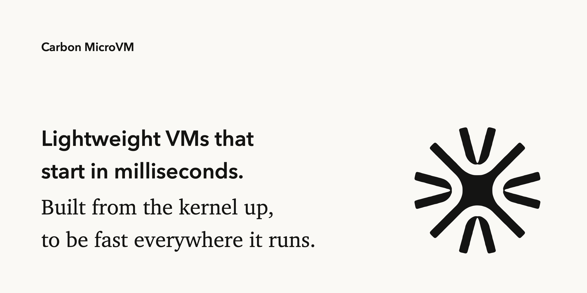

**Carbon runs Linux and Windows programs in machines of their own, on macOS, Linux and Windows, with no guest OS to
install.**

A machine gives a program its own disk, network, processes and memory, walled off from the host and from every other
machine. Traditional VMs get there by booting a guest operating system. Carbon boots nothing: it brings its own
kernels, written from scratch in Rust, so a machine is ready the moment it starts, and program code runs straight on
the CPU, inside a hardware VM or a process sandbox.

```sh
carbon run debian:13 -- bash                            # a Linux image, with lambda
carbon run setup.exe                                    # a Windows program, with atlas
carbon run --isolation vm debian:13 -- ./untrusted.sh   # a hardware VM, or fail
carbon run --platform linux/amd64 debian:13 -- apt-get install -y curl   # x86-64, translated on Apple silicon
```

[%20%7C%20Linux%20x86--64%20%7C%20Windows%20x86--64-333333?style=flat-square)](#where-it-runs)
[](LICENSE)

## Why Carbon

- **The kernel brings the OS, the image brings the software.** **lambda** speaks Linux's system calls and runs
  unmodified OCI images: Debian's own glibc, bash, apt, Python and git. **atlas** is all of Windows as one Rust
  module, so a Windows program runs with no Windows files anywhere: its DLLs are made in memory.
- **A hardware VM, or a sandbox, and you know which.** Each host has two ways to run code: a hardware VM (`vm`) and a
  process sandbox for where there's no hypervisor (`sandbox`). `carbon` takes the VM where it can, and when it can't,
  it says so and why. It never falls back silently.
- **Native speed.** Program code runs directly on the CPU, and the hardware walks its page tables. A machine takes the
  memory its programs touch, and nothing more.
- **x86 on Apple silicon.** A built-in translator, with the CPU's own TSO mode for x86 memory ordering: Debian's
  x86-64 image installs packages with apt, translated.
- **A network of its own, over the host's sockets.** Each machine has its own addresses, loopback and DNS, with no
  virtual network card: its connections are the host's, so they go as fast as the host's.
- **Screens for computer use.** One desktop both kernels' windows go on, headless or in the host's own windows (on
  macOS today), with screenshots, clicks and keys from the command line, and later remote viewers over QUIC.

## Where it runs

| Host | `vm` | `sandbox` |
| --- | --- | --- |
| macOS, Apple silicon | `hvf`, Hypervisor.framework: ARM64 natively, x86-64 translated | a stub task running rewritten ARM64 code (one CPU) |
| Linux x86-64 | `kvm`: native x86-64 | a stub process under `ptrace`, Syscall User Dispatch and seccomp (one CPU) |
| Windows x86-64 | `winkvm`, Carbon's own VT-x driver (test-signed) | a stub process under the debug API, a restricted token and a job (one CPU, atlas only) |

All six backends run real programs and pass the same conformance suite. Linux and Windows are tested in GCP VMs with
nested virtualization. [`exec`](exec/README.md) has what each runs, and what's left.

## Quickstart

You need Rust. On macOS the binary is signed for the hypervisor.

```sh
cargo build --release -p cli
codesign --force --sign - --entitlements carbon.entitlements target/release/carbon   # macOS only

carbon run debian:13 -- bash                 # pulled if it isn't here; a machine called debian
carbon run --name dev debian:13              # named: `carbon run --name dev` starts it again, files as they were
carbon run setup.exe                         # a Windows program, on a disk of its own
carbon ls                                    # NAME  FROM  ISOLATION  STATUS
carbon stop dev                              # SIGTERM to its first process; everything ends 10 s later
carbon freeze dev mine:1                     # an image of a stopped machine's disk
carbon display screenshot app -o screen.png  # a running machine's screen
carbon pull debian:13 | images | rmi IMAGE | rm NAME
```

Everything is kept in `CARBON_HOME`, or `~/.carbon`. [`cli`](cli/README.md) has every option, and what's coming.

## What a machine is

| Part | Module | What it is | State |
| --- | --- | --- | --- |
| The CPUs and memory | [`exec`](exec/README.md) | Runs a program's machine code in a hardware VM or a process sandbox, and stops it whenever it needs its kernel | Built, on all three hosts |
| The OS | [`kernels`](kernels/README.md) | lambda (Linux) and atlas (Windows), on a shared `kernels-core`; [obsidian](kernels/obsidian/README.md) (Android) later | Being built |
| The disk | [`layers`](layers/README.md) | The file system programs see: an image's index, merged, with the machine's own log on top | Built |
| The screen | [`display`](display/README.md) | The desktop both kernels' windows go on: frames, stacking, focus and input, on a screen in memory or the host's windows | The desktop is built, and shown on macOS, whole or a Mac window for each window |
| The sound | [`audio`](audio/README.md) | The mixer every program's sound goes into, and the microphone | Not started |
| The network | [`net`](net/README.md) | Every socket: the machine's addresses, loopback, Unix sockets and DNS, out through the host's sockets | Out works; in, policy and Winsock to do |
| The host | [`host`](host/README.md) | Standard streams, clocks, randomness, memory, the terminal, certificate trust | Built |

Around them:

| Module | What it is | State |
| --- | --- | --- |
| [`images`](images/README.md) | What machines start from, on the host's disk: pulled OCI images, imports, frozen machines | Built |
| [`machine`](machine/README.md) | Puts one machine together and owns its life | Built, for what exists |
| [`remote`](remote/README.md) | A machine's desktop and sound, shown and driven from another computer over QUIC | Not started |
| [`cli`](cli/README.md) | The `carbon` command | Built |
| [`sdk`](sdk/README.md) | Carbon as a Rust library | Not started |

```
cli, sdk ──► machine ──► kernels ──► exec, layers, display, audio, net, host
   │            │        (core ◄── lambda, atlas)
   │            └──────► remote ──► display, audio
   └──► images ──► layers
```

The kernels make windows and sound; `display` and `audio` decide where they go. Locally that's the host's own
windows and speakers (or a screen in memory, or nothing); remotely, `remote` reads the same desktop and mixer and
serves them to a viewer. The kernels can't tell the difference.

## Rules

For the whole project:

1. **The kernel brings the OS; the image brings the user's software.** Nothing that belongs to an OS is a file Carbon
   builds, installs or reads back. atlas's DLLs and lambda's `/proc` are made in memory. An image's own files (glibc,
   an app's DLLs) are used as they are.
2. **One host, two backends, per host-facing module.** Each host has exactly one `vm` and one `sandbox` backend in
   `exec`. `display`, `audio`, `net` and `host` follow the same pattern: a shared part on top, one folder per host,
   and every host-specific line inside its host's folder.
3. **Dependencies point one way**, as drawn above. Nothing outside `machine/` depends on a kernel, no kernel knows
   `remote` exists, and `exec` depends on nothing of Carbon's.
4. **Backends answer a contract and nothing more.** Anything that isn't about one host is written once, above it.
5. **Constants live with what they describe.** Facts about a CPU go in `exec::isa`, tunable policy in `Tuning`, a host
   API's numbers in that host's `sys.rs`. There is no `consts.rs`.
6. **One conformance suite per contract.** Every backend runs the same tiny programs and must give the same results.
   A backend is done when it passes.
7. **No dependencies we can do without.** `libc` and each host's system libraries; `rustls` where TLS can't be
   avoided, inside the one crate that needs it.
8. **Crate names.** Inside a family, each crate keeps the family's prefix and its folder drops it: `exec/core` is
   `exec-core`, `kernels/atlas/abi` is `atlas-abi`.

## Words

| Word | Meaning |
| --- | --- |
| **machine** | One running instance: a kernel, its exec, its layers, its display, its audio and its network |
| **image** | What a machine starts from: an OCI image's layers, or a frozen machine |
| **layer** | One level of a machine's file system; the top one is writable |
| **isolation** | `vm` or `sandbox` (or `auto` when choosing) |
| **backend** | One way of running code on one host: `vm/hvf`, `sandbox/linux`, … |
| **space** | An address space: one program's page tables |
| **frame** | A page of guest memory that the kernel holds, which spaces can map |
| **turn** | A CPU's time in the kernel. Ending it settles: TLBs synced, memory given back |
| **exit** / **stop** | What `Cpu::run` returns (opaque) / what it means to a kernel (`Stop::Syscall`, `Stop::Fault`, …) |
| **preempt** | Make a running CPU stop at the next safe point, as `Stop::Preempted` |
| **shim** | The few pages of code and tables a `vm` backend puts in the guest, above the program |
| **mirror** | How a `sandbox` keeps the stub's host mappings matching core's page tables |
| **gate** | Where a sandboxed program's system calls arrive, where the host can't trap them |
| **granule** | The smallest unit a host can map: 4 KiB (Linux x86-64), 16 KiB (macOS), 64 KiB (Windows views) |
| **translate** | Running one ISA's code on another, or rewriting code for the same ISA |
| **host export** | A Windows DLL export whose body is host Rust in atlas, reached through a trap stub |
| **guest code** | atlas's `ntdll` (`atlas/guest`): the part of Windows that has to run inside the program |
| **upcall** | atlas running the program's callback from host Rust, nested, and coming back |
| **system layer** | The `C:\Windows` atlas makes for every machine, since there's no Windows image to bring |
| **desktop** | `display::Desktop`: a machine's top-level windows, their frames, stacking, focus and input, whichever kernel made them |
| **mixer** | `audio`'s: every program's sound streams, converted and mixed for each output |
| **viewer** | `carbon connect`, showing a machine's desktop from another computer |
| **network** | `net::Network`: a machine's addresses, loopback, ports and policy; a named one (`--net lab`) is shared by machines |
| **publish** | Make a machine's port reachable from a host port (`--publish 8080:80`) |

## Building and testing

```sh
cargo build --workspace
cargo clippy --workspace --all-targets
cargo test --workspace

# exec's conformance suite: the same programs on both of this host's backends (signed first on macOS)
cargo build --release --example conformance
codesign --force --sign - --entitlements carbon.entitlements target/release/examples/conformance
target/release/examples/conformance

# net's conformance suite: sockets out through this host's own
cargo run -p net --example net-conformance

# Linux and Windows programs on lambda and atlas, without a machine around them
cargo build --example run --example run-windows
```

A binary that opens a backend on macOS is signed with `carbon.entitlements` (`hypervisor`, `cs.debugger`,
`get-task-allow`). On Linux, kvm needs the user in the `kvm` group. On Windows, `winkvm.sys` is built with the WDK and
test signing is on (`exec/windows/driver/README.md`). Each module's README has its own tests; the kernels' test
programs and how to build them are in [lambda's](kernels/lambda/README.md#running-and-testing) and
[atlas's](kernels/atlas/README.md#running-and-testing) READMEs.

## Where it stands

- **exec** runs on all three hosts, both isolations, and all six backends pass its conformance suite. A dropped CPU's
  slot is used again, so a machine can make threads and processes for as long as it runs.
- **lambda** runs Debian 13, ARM64 natively and x86-64 translated or native: bash with job control on a console,
  ptys, signals, threads, `epoll` and friends, sockets, and `apt-get install` of curl, Python and git, which then
  work over HTTPS. **atlas** runs Windows programs with its loader and SEH, threads, processes and objects, pipes,
  sections, asynchronous I/O, files, the registry, security, resources and system information, and windows on the
  desktop with input, dialogs and the basic controls, on ARM64, x86-64 and 32-bit x86.
- **`carbon run debian:13 -- bash`** works on all three hosts, from an image pulled over HTTPS (trusting what the host
  trusts), with machines kept by name, stopped, frozen and started again.
- **net** gives each machine its own network out through the host's sockets: `apt-get update` and `curl https://`
  work in `debian:13` on all three hosts.
- **display** has the desktop on a screen in memory, and on a Mac's screen: whole in one window (`--display host`), or
  each window in a Mac window of its own (`--display host-windows`). **audio**, **remote** and **sdk** are designed, not started.

## The order of work

Most foundational first: exec, then the machine you run, then what the kernels need for real software, then windows,
networks, remote use and sound, then reach and polish. Within a tier the order is importance; when something later
blocks real work, it moves up. Each item's detail is in the README it links to.

**1. The foundation: exec, correct and everywhere** ([exec](exec/README.md#to-do), [kernels-core](kernels/README.md#kernels-core-1))

1. The sandboxes finished: more than one CPU in each; lambda on the Windows sandbox (x86 → x86 rewriting); the
   kernels' programs on the macOS sandbox; whole runs of pages per `ptrace` call on Linux. *Done means:* both kernels'
   test programs pass on every sandbox.
2. x86-64 programs as they're built: the x87 transcendentals, `pushf`/`popf`, signed 128-bit divides, the remaining
   flags and string instructions, `cmpxchg16b`; SSE3 and later, then AVX, as programs ask.
3. The translator's speed and safety: code written through a second mapping (JITs like .NET's). *Done means:* a real
   JIT (a JavaScript engine, or LuaJIT) runs in an x86-64 image.
4. exec's core faster and safer: ASIDs and VPIDs, hvf moving only the registers used, one translation runtime in
   core, hvf's VM kept until its last CPU is dropped.
5. kernels-core's last pieces: the clock page, and trimming the page cache under memory pressure.

**2. A machine you can run** ([layers](layers/README.md#to-do), [images](images/README.md#to-do), [machine](machine/README.md#to-do))

`carbon run debian:13 -- bash` works. Left: compacting a running machine's log; zstd layers, registry logins,
streaming layers, clearing unused chunks; the image's working directory and user; stopping and screenshots from
another process on Windows hosts; a worker process per machine.

**3. lambda runs real Linux software** ([lambda](kernels/lambda/README.md#to-do))

1. Processes: `execve` with other threads running, a `vfork` that shares memory, `clone3`, `rseq`, permissions checked
   against credentials.
2. Memory and files: shared file mappings written back, `msync`; more of sysfs and `/proc`.
3. The vDSO's counter on every host (Apple silicon's reads it already), and `time`, `getcpu` and `getrandom` in it.
4. Signals' remainder: queued real-time signals, `rt_sigtimedwait`, `setitimer`, `alarm`, SIGTTOU, the FP state in the
   frame, core dumps.
5. `apt install` on the Linux and Windows hosts, and locks that hold between processes.
6. A console on Windows hosts, checked with a full-screen editor.

**4. atlas runs real Windows programs and installers** ([atlas](kernels/atlas/README.md#to-do))

1. The loader's last piece: manifests (side-by-side assemblies and activation contexts). The PEB's lists,
   `FreeLibrary` that unloads, detach, delay loads and API sets are done.
2. C++ exceptions. (Vectored handlers, guard pages and stack overflow are done.)
3. The C runtime's rest, as a MinGW C++ program asks (`setjmp`, `_beginthreadex`, low-level I/O, `strftime`, math).
   (ucrtbase's startup, heap, strings, stdio and printf are done, so MinGW-built C programs run; FLS is done.)
4. Threads: the thread pool's callback priorities. (Fibers and the thread pool, with its I/O and timer queues, are
   done.)
5. Files: other drives. (Sharing modes, hard and symbolic links, and file times that can be set are done.)
6. The registry: Windows' own hive format, for hives from a real Windows. (Change notification, the 32-bit view, and
   saving, restoring, loading and unloading hives are done.)
7. 32-bit x86, which installers are: exec's 32-bit translation, the i686 ntdll, `SysWOW64`.
8. Winsock over `net` (with `net`'s phase 4). *Done means:* a Windows program downloads over HTTPS.
9. `msiexec` in host Rust, and `cmd.exe`, `reg.exe`, `regsvr32.exe`, `rundll32.exe`. *Done means:* a real `.msi`
   installs.
10. The long tail of exports, as the `missing` stubs and `carbon atlas imports` name them. (Code pages, the `*A`
    functions and ANSI windows are done.)

**5. The desktop, and programs with windows** ([display](display/README.md#to-do), [atlas](kernels/atlas/README.md#2-the-window-kernel))

1. The desktop on Linux and Windows hosts' screens, as it is on the Mac's.
2. The desktop's rest: WM_NCHITTEST and frames a program draws itself, keyboard layouts besides US.
3. atlas's user interface: menus, comctl32's controls, the list box and combo box, `MsgWaitForMultipleObjects`.
   (Dialogs, with buttons, statics and edits, are done.)
4. GDI: bitmaps and memory DCs, DIB sections with shared pages, regions and shapes, real fonts.
5. lambda's Wayland and X11 servers, so GTK, Qt and Firefox run.
6. Graphics APIs: OpenGL, Direct3D and DXGI, and how they reach the host's GPU.

**6. Networks** ([net](net/README.md#to-do))

1. In, and policy: `--publish`, `--net none` and `host`, `--allow` and `--deny` with a log, `--dns`, `carbon port`.
2. Between machines: named networks, names in DNS, `carbon net`.
3. ICMP echo, IPv6 end to end, broadcast and multicast, as programs ask.

**7. Remote** ([remote](remote/README.md#to-do))

1. A first picture: desktop observers, QOI and kept tiles, QUIC with keys, `carbon connect`. *Done means:* atlas's
   `desktop.c` is driven from another computer, and the viewer's PNG equals the server's screenshot.
2. Fast on real links. 3. Busy content. 4. The rest: H.264, cursors, clipboard, files, sound, a host-wide gateway.

**8. Sound** ([audio](audio/README.md#to-do))

1. The mixer, record streams, a WAV output, and `audio/macos`; then Linux and Windows.
2. lambda's PulseAudio server. 3. atlas's winmm, WASAPI and DirectSound.

**9. Reach and polish**

1. [The SDK](sdk/README.md#to-do).
2. Linux ARM64 hosts; ARM64 → x86-64 translation ([exec](exec/README.md#5-more-hosts-and-isas)).
3. The macOS sandbox: shared memory, x86 programs, the rest of ARM64; the Windows sandbox hardened; winkvm's rest
   (NMIs, VPID, kernel CET, AMD SVM, signing) ([exec](exec/README.md#4-safety-and-robustness)).
4. Debugging: per-backend detail in `CARBON_EXEC_DEBUG`.
5. [obsidian](kernels/obsidian/README.md), Android programs.

## Decisions still open

Each blocks the work named; the README linked has the details and a recommendation.

| Question | Blocks | Where |
| --- | --- | --- |
| The `auto` default: fall back loudly, or `vm` wherever there's a hypervisor? | — | [cli](cli/README.md#open-question) |
| The macOS sandbox with 16 KiB pages: strictest protection, or check accesses in software? | the macOS sandbox | [exec](exec/README.md#open-questions) |
| Syscall User Dispatch on Linux ARM64, or rewriting? | Linux ARM64 | [exec](exec/README.md#open-questions) |
| `get-task-allow` on macOS, or another way to take the stub's task? | the macOS sandbox | [exec](exec/README.md#open-questions) |
| How the Windows driver is signed (EV certificate, attestation) | shipping winkvm | [exec](exec/README.md#open-questions) |
| Graphics APIs: host exports, guest code, or a GPU protocol? | graphics | [atlas](kernels/atlas/README.md#open-questions) |
| QUIC and TLS for remote: `quinn` and `rustls`, or our own? | remote's first picture | [remote](remote/README.md#open-questions) |
| One remote port per machine or a host gateway; 4433 or 443 by default | remote | [remote](remote/README.md#open-questions) |
| TLS for atlas's WinHTTP and Schannel: `rustls` in one crate, or our own? | Winsock's HTTPS | [net](net/README.md#open-questions) |
| Machines' networks between processes: registry files, or a daemon? | networks between machines | [net](net/README.md#open-questions) |
| A user-mode TCP/IP stack for packets (raw sockets, `tun`), ever? | — | [net](net/README.md#open-questions) |
| obsidian: its own kernel, or lambda with Android's devices? | obsidian | [obsidian](kernels/obsidian/README.md) |

## Why it's built this way

| The easy way | What goes wrong | Here |
| --- | --- | --- |
| One big engine trait every backend implements | Memory bookkeeping written once per backend, and backends that drift apart | A small contract per isolation, and core does the rest |
| Kernels generic over the engine (`Kernel<E: Engine, H: Host>`) | Every kernel type carries the engine | One concrete `Exec` |
| One kernel lock around everything | A blocked syscall holds up everyone's page faults | Short turns, per-process locks, exec's lock as the leaf |
| Windows' DLLs as files installed on the machine's disk | A second build, an install step, a version handshake between halves of one program | DLLs made in memory from declarations; one embedded guest crate |
| Trusting that a backend works because its programs finish | A fallback can quietly do the work instead | A conformance suite every backend must pass |

[exec](exec/README.md#why-its-shaped-this-way) and [atlas](kernels/atlas/README.md#how-it-works) have the rest.

## Developing

Linux and Windows hosts can be tested on cloud VMs with nested virtualization (on GCP, an Intel N2 machine type with
`--enable-nested-virtualization`, so the guest has VT-x):

- **Linux**: 2 CPUs, 8 GB and a 50 GB disk are enough. Debian or Ubuntu, the user in the `kvm` group (for
  `/dev/kvm`), `build-essential clang lld llvm pkg-config python3`, and rustup's stable toolchain with `rust-src` and
  both Windows targets. If the distribution's `lld-link` is too old for the exports rustc writes, point it at the
  toolchain's own `rust-lld`.
- **Windows**: Windows Server 2022 with 4 CPUs, test signing on (`bcdedit /set testsigning on`), Visual Studio Build
  Tools, the WDK, LLVM and Rust. `winkvm.sys` starts on demand, not at boot: `sc.exe start winkvm` after each restart.

Copy the source over with rsync, without `target/`. In zsh, quote the destination (`"$IP:carbon"`), since an unquoted
`$IP:carbon` reads `:c` as a modifier and copies locally.

## License

Apache 2.0. See [LICENSE](LICENSE).
