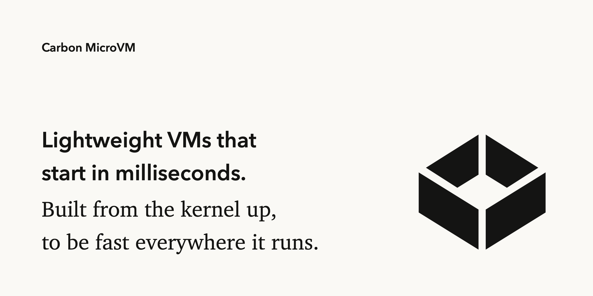

**Carbon runs Linux and Windows programs in machines of their own, on macOS, Linux and Windows, with no guest OS to
install.**

A machine gives a program its own disk, network, processes and memory, walled off from the host and from every other
machine. Traditional VMs get there by booting a guest operating system. Carbon boots nothing: it brings its own
kernels, written from scratch in Rust, so a machine is ready the moment it starts, and program code runs straight on
the CPU, inside a hardware VM or a process sandbox.

Every image runs on one of Carbon's two kernels:

```console
$ carbon images
KERNEL  IMAGE         PLATFORM       FROM
atlas   atlas:latest  windows/arm64  imported
lambda  debian:13     linux/arm64    imported
```

- **lambda** is Linux's kernel, in Rust: it speaks Linux's system calls, so `debian:13` and any other Linux image run
  as they are, with their own bash, apt and glibc.
- **atlas** is Windows' kernel and its system DLLs (ntdll, kernel32, user32 and the rest), in Rust and made in memory,
  so a Windows program runs with no Windows files anywhere. Its programs (`cmd.exe`, `powershell.exe`) come from the
  image `atlas`, [atlas-base](https://github.com/tensorai-co/atlas-base).

```sh
carbon run -it debian:13 bash                                  # a shell in a Linux image, with lambda
carbon run setup.exe                                           # a Windows program, with atlas
carbon run -it atlas powershell                                # atlas-base, Carbon's Windows userland, and its PowerShell
carbon run --name web -p 8080:80 debian:13 -- python3 -m http.server 80   # a port the host reaches
carbon exec -it web bash                                       # from another terminal: a shell in it, as docker exec
carbon run --isolation vm debian:13 -- ./untrusted.sh          # a hardware VM, or fail
carbon run --platform linux/amd64 debian:13 -- apt-get install -y curl    # x86-64, translated on Apple silicon
carbon run --deny 0.0.0.0/0 --allow pypi.org:443 --deny-exec 'rm -rf *' debian:13 -- ./agent-step.sh   # rules
carbon run --deny 0.0.0.0/0 --registries apt --upstream https://pkg.example.com debian:13 -- apt-get install -y jq   # packages, with no network out
carbon watch web                                               # every program it starts, what it writes, where it connects
claude mcp add carbon -- carbon mcp                            # an agent's machines, as MCP tools: run, exec, files, builds, screens
carbon mcp -H 0.0.0.0:8080 --token-file tokens --engine        # the same over HTTP and WebSocket, and the Engine API for the programs running agents
```

And as a Rust library, from GitHub:

```rust
let carbon = carbon::Carbon::open()?;
let out = carbon.machine("debian:13").rm(true)
    .on_exec(Filter::program("curl"), |_| Decision::deny())          // decided as it starts, in the kernel
    .output(["sh", "-c", "./agent-step.sh"])?;
```

[%20%7C%20Linux%20x86--64%20%7C%20Windows%20x86--64-333333?style=flat-square)](#where-it-runs)
[](LICENSE)

## Why Carbon

- **The kernel brings the OS, the image brings the software.** **lambda** speaks Linux's system calls and runs
  unmodified OCI images: Debian's own glibc, bash, apt, Python and git. **atlas** is Windows' kernel and its runtime
  DLLs as one Rust module, so a Windows program runs with no Windows files anywhere: its DLLs are made in memory.
  Programs, Windows' own included, come in images ([below](#what-comes-with-carbon-and-what-comes-in-an-image)).
- **A hardware VM, or a sandbox, and you know which.** Each host has two ways to run code: a hardware VM (`vm`) and a
  process sandbox for where there's no hypervisor (`sandbox`). `carbon` takes the VM where it can, and when it can't,
  it says so and why. It never falls back silently.
- **Native speed.** Program code runs directly on the CPU, and the hardware walks its page tables. A machine takes the
  memory its programs touch, and nothing more.
- **x86 on Apple silicon.** A built-in translator, with the CPU's own TSO mode for x86 memory ordering: Debian's
  x86-64 image installs packages with apt, translated.
- **Used as Docker is.** `carbon run` with `-i`, `-t`, `-p` and `--network`, and `carbon exec -it` into a running
  machine, mean what they mean in Docker, for Linux images and Windows programs alike.
- **A network of its own, over the host's sockets.** Each machine has its own addresses, loopback and DNS, with no
  virtual network card: its connections are the host's, so they go as fast as the host's. Ports are published as
  Docker publishes them (TCP and UDP, the client's own address seen inside), or a machine takes the host's network.
- **A Windows userland of its own.** [atlas-base](https://github.com/tensorai-co/atlas-base) is `cmd.exe`,
  `powershell.exe` and the everyday command-line tools, written for Carbon as real Windows programs and built from
  source into an image, so `carbon run -it atlas` is a Windows prompt with no Microsoft files anywhere.
- **Screens for computer use.** One desktop both kernels' windows go on, headless or in the host's own windows (on
  macOS today), with screenshots, clicks and keys from the command line, and later remote viewers over QUIC.
- **Built for agents.** Because Carbon owns the kernels, a program using it sees, in real time, every program a
  machine starts, everything it writes, every connection it makes, every name it looks up and every package it asks
  for, and can allow, block, rewrite or answer each one while the machine waits. A container runtime can't, because it doesn't own the kernel.
- **`carbon mcp` is the front door.** Carbon is AI-first: an agent's client starts `carbon mcp` and gets machines as
  MCP tools, and the program running the agent (a gateway, CI, an app) sets those machines up over the same server's
  Engine API, on one connection ([below](#for-agents-carbon-mcp)).
- **A Rust library first.** [`carbon`](carbon/README.md) is an ordinary crate, a git dependency away
  ([below](#as-a-rust-library)); the `carbon` command and `carbon mcp` are thin layers over it.

## What comes with Carbon, and what comes in an image

Carbon splits a machine in two, the same way for every kernel:

- **Built in: the engine and its kernels.** The foundational APIs (display, sound, GPU, networking, clocks, the
  terminal, certificate trust) are builtins: Carbon's own Rust modules, there in every machine. The kernels are
  ordinary Rust modules too. **lambda** is Linux's system calls, `/proc`, `/sys` and the vDSO. **atlas** is the NT
  kernel's calls *and* Windows' runtime DLLs (ntdll, kernel32, user32, gdi32, advapi32, ucrtbase and the rest),
  because on Windows those DLLs are the kernel's interface: every program links against them, and they have to match
  the kernel under them. So a `.dll` of Windows' own is part of atlas, made in memory. It is never a file in an image.
  An image doesn't carry its own copy of Windows, and atlas's DLLs are never stored twice.
- **From an image: everything that's a program.** Anything that isn't foundational is a program, and comes with an
  image, as it would in Docker: bash, apt and glibc from `debian:13` or any other Linux image, and `cmd.exe`,
  `powershell.exe`, `findstr` and the rest of Windows' userland from **atlas-base**. A program an image brings uses
  the image's own files (glibc, an app's own DLLs) as they are.

```
 an image (pulled, or imported)                  Carbon (one binary)
┌──────────────────────────────────┐            ┌──────────────────────────────────────────────────┐
│ debian:13, ubuntu, any Linux:    │   runs on  │ lambda    Linux's system calls, /proc, the vDSO  │
│   bash, apt, glibc, python, ...  │ ────────►  │                                                  │
│ atlas (atlas-base):              │            │ atlas     NT's calls, and the runtime DLLs:      │
│   cmd.exe, powershell.exe,       │ ────────►  │           ntdll, kernel32, user32, ucrtbase, ... │
│   where, findstr, ...            │            │           the registry, windows, the console     │
│ your own: an app, an installer   │            ├──────────────────────────────────────────────────┤
└──────────────────────────────────┘            │ builtins  display, audio, gpu, net, host         │
                                                │ engine    exec (hvf, kvm, winkvm, sandboxes),    │
                                                │           layers, images, machine                │
                                                └──────────────────────────────────────────────────┘
```

The two kernels draw the line where their OS draws it. Linux's interface is its system calls, so lambda stops there,
and glibc is the image's. Windows' interface is its system DLLs, so atlas includes them, and `cmd.exe` (just a
program that calls kernel32) is the image's.

**atlas-base** is Carbon's Windows userland, in a repository of its own,
[tensorai-co/atlas-base](https://github.com/tensorai-co/atlas-base). Like Debian, it's built from source, with no
Microsoft binaries. It's built locally and imported:

```sh
git clone https://github.com/tensorai-co/atlas-base && cd atlas-base && ./build.sh
carbon import --platform windows/arm64 -c 'CMD ["cmd.exe"]' out/atlas-base-arm64.tar atlas   # windows/amd64 on x86-64
carbon run -it atlas                                                                         # cmd.exe's prompt
```

Or, soon, pulled from Docker Hub as `tensoraico/atlas`, like any image: `carbon run -it tensoraico/atlas`. A Windows
machine with no image (`windows`, or a program from the host such as `carbon run setup.exe`) has atlas's
`C:\Windows` and its DLLs, and no programs.

## Where it runs

| Host | `vm` | `sandbox` |
| --- | --- | --- |
| macOS, Apple silicon | `hvf`, Hypervisor.framework: ARM64 natively, x86-64 translated | a stub task running rewritten ARM64 code (one CPU) |
| Linux x86-64 | `kvm`: native x86-64 | a stub process per CPU that handles its own traps, catching calls with Syscall User Dispatch, or seccomp where there's none (gVisor, Linux before 5.11) |
| Windows x86-64 | `winkvm`, Carbon's own VT-x driver (test-signed) | a stub process under the debug API, a restricted token and a job (one CPU, atlas only) |

All six backends run real programs and pass the same conformance suite. Linux and Windows are tested in GCP VMs with
nested virtualization: through kvm and winkvm, both kernels' x86-64 test programs pass (but for lambda's vDSO clock
page), and atlas's 32-bit ones through winkvm. The Linux sandbox runs the same lambda programs, with no hypervisor
(an e2 VM without nested virtualization, and inside gVisor, as on Cloud Run): `debian:13`'s shells, pipelines and
`apt-get install`, and Python's threads and subprocesses. [`exec`](exec/README.md) has what each runs, and what's
left.

## Quickstart

You need Rust. On macOS the binary is signed for the hypervisor.

```sh
cargo build --release -p cli
codesign --force --sign - --entitlements carbon.entitlements target/release/carbon   # macOS only

carbon run -it debian:13 bash                        # pulled if it isn't here; a machine called debian; -it: a shell
carbon run debian:13 -- ls /                         # a command: its output here, and no stdin (-i gives it this one's)
carbon run -it --name dev -p 2222:22 debian:13 bash  # named, with a port; `carbon run --name dev` starts it again
carbon exec -it dev bash                             # from another terminal, a shell in it (-i -t -d -e -w, as docker)
carbon run -d -P --name web nginx:alpine             # in a process of its own, every port its image exposes published
carbon logs -f web                                   # what it writes; carbon cp ./site web:/srv works while it runs
carbon import -c 'CMD ["cmd.exe"]' atlas-base-arm64.tar atlas   # atlas-base, built from its repository (see above)
carbon run -it atlas                                 # a Windows prompt: atlas-base's cmd.exe (powershell, findstr...)
carbon run setup.exe                                 # a Windows program from this host, on a disk of its own
carbon run --display host setup.exe                  # on this Mac's screen and speakers
carbon ps                                            # NAME  FROM  ISOLATION  STATUS  PORTS
carbon port dev                                      # 22/tcp -> [::]:2222
carbon stop dev                                      # SIGTERM to its first process; everything ends 10 s later
carbon commit dev mine:1                             # an image of a machine's disk, running or not, as docker commit
carbon display screenshot app -o screen.png          # a running machine's screen
carbon inspect nginx:alpine                          # an image's whole config and history; carbon tag, carbon history
carbon build -t app:1 .                              # an image from a Carbonfile, which is any Dockerfile, exactly
carbon run -v ~/work:/work -v data:/data debian:13   # a host folder seen live, and a volume that outlives the machine
carbon pull debian:13 | import TAR NAME | images | rmi IMAGE | rm NAME
carbon login -u someone && carbon push someone/app:1   # a layer per step; carbon save | carbon load, as Docker's
```

Everything is kept in `CARBON_HOME`, or `~/.carbon`. [`cli`](cli/README.md) has every option, and what's coming.

## As a Rust library

Everything `carbon` does, a Rust program does with the crate [`carbon`](carbon/README.md), from GitHub:

```toml
[dependencies]
carbon = { git = "https://github.com/tensorai-co/carbon" }
```

```rust
use carbon::hooks::{Decision, Filter, Reply};
use carbon::{Carbon, Network, Rules};

fn main() -> carbon::Result<()> {
    carbon::init(); // first: the process sandbox's stub is this binary, run again
    let carbon = Carbon::open()?;

    // A command in a machine of its own, removed after, and what it wrote.
    let out = carbon.machine("debian:13").network(Network::None).rm(true).output(["uname", "-a"])?;
    print!("{}", out.stdout_lossy());

    // A machine whose programs, output and connections are decided as they happen.
    let dev = carbon
        .machine("debian:13")
        .name("dev")
        .on_exec(Filter::program("apt-get"), |_| Decision::answer(Reply::new().stdout("Done\n").exit(0)))
        .on_output(Filter::any(), |o| o.replace(o.text().replace("hunter2", "*******")))
        .rules(Rules::new().deny_exec("chmod 777 *").deny("0.0.0.0/0")?.allow("pypi.org:443")?)
        .start(["sleep", "infinity"])?;
    let ls = dev.machine().exec(["ls", "/"]).output()?; // as docker exec
    print!("{}", ls.stdout_lossy());
    dev.stop();
    dev.wait()?;
    Ok(())
}
```

A program using it calls `carbon::init()` first, and on macOS is signed with [`carbon.entitlements`](carbon.entitlements)
for the hypervisor, as `carbon` is. It needs Rust 1.85 with `rust-src`, and LLVM's `lld-link` and `ld.lld` to build
Windows' guest code (without them, Linux machines still run). [`carbon`'s README](carbon/README.md) has every type,
the hooks and what each kernel does with each decision, and [`examples/agent.rs`](carbon/examples/agent.rs) runs.

## For agents: `carbon mcp`

`carbon mcp` is an MCP server over a Carbon home. There are two planes on one server:

| | MCP | The Engine API (`--engine`) |
| --- | --- | --- |
| For | A model | The program that runs models: a sandbox's gateway, CI, an app |
| What it has | Task-shaped tools: `run`, `exec`, `read_file`, `edit_file`, `commit_machine`, `screenshot`, … | Machines and images with every setting: hostname, env, secrets in a tmpfs, mounts, rules, commit, push |
| Methods | MCP's own: `tools/list`, `tools/call`, … | `engine/machines.create`, `engine/machines.exec`, `engine/files.write`, `engine/images.push`, …, never in `tools/list` |

Anything relaying an agent's calls forwards MCP's methods and never `engine/…`, so an agent can't set its own keys or
loosen its own network, even on a shared connection.

```sh
claude mcp add carbon -- carbon mcp                          # stdio: the client starts it, and is its only client
carbon mcp -H 127.0.0.1:8080                                 # HTTP (MCP at POST /mcp) and WebSocket, this host only
carbon mcp -H /run/carbon.sock --engine                      # a Unix socket (0600), with the Engine API
carbon mcp -H 0.0.0.0:8443 --tls --tlscert cert.pem --tlskey key.pem --token-file tokens --engine
carbon mcp -H 0.0.0.0:$PORT --engine --max-sessions 1 --no-auth   # one session, then exit: a sandbox host behind a gateway
carbon mcp token --scope carbon:mcp,carbon:engine --name ci  # a new token, and its line for --token-file
```

- **One address, every protocol.** `-H` takes `host:port` or a socket's path (repeatable). `POST /mcp` is MCP's
  Streamable HTTP; `/v1/…` is the Engine API as REST (`POST /v1/machines`, `POST /v1/machines/{name}/exec`,
  `PUT /v1/machines/{name}/files?path=…`, …); a WebSocket carries everything on one connection. Its text messages are
  JSON-RPC, MCP's and `engine/…` alike, and its binary messages are streams' bytes (`[stream: u32][kind: u8][bytes]`:
  stdin, stdout, stderr, exit, data, end), so output and files never go as base64.
- **Who may connect.** stdio and a Unix socket need no token. Loopback needs none, with a warning. Anything else needs
  `--token-file` (lines of `SCOPES SHA256 NAME`; scopes `carbon:mcp` and `carbon:engine`), unless `--no-auth` says
  something in front does auth. Requests with an `Origin` must come from an `--allow-origin`. TLS is 1.3.
- **`--max-sessions N`** serves N sessions in all, then exits, so each session can get a fresh host. A session is a
  connection that's made a request, so a health check (`GET /_ping`) or a TCP probe doesn't use one up.

A session, as a gateway runs one on a WebSocket: a machine from a workspace image with its hostname, env, a tmpfs and
rules; the session's token written into the tmpfs (a tmpfs isn't the disk, so `commit` never saves it); commands with
their output streamed; then commit, push, close.

```
→ {"jsonrpc":"2.0","id":1,"method":"engine/machines.create","params":{"Image":"registry/ws/8f3a:latest","Name":"sbx-8f3a","Hostname":"sbx-8f3a","Env":["TURN=1"],"Cmd":["sleep","infinity"],"HostConfig":{"Tmpfs":{"/run/secrets":""}},"Rules":{"Deny":["0.0.0.0/0"],"Allow":["git.internal:443"]}}}
→ {"jsonrpc":"2.0","id":2,"method":"engine/machines.start","params":{"Id":"sbx-8f3a"}}
→ {"jsonrpc":"2.0","id":3,"method":"engine/files.write","params":{"Id":"sbx-8f3a","Path":"/run/secrets/token","Mode":384,"Stream":1}}
→ [1][data] <token>   [1][end]
→ {"jsonrpc":"2.0","id":4,"method":"engine/machines.exec","params":{"Id":"sbx-8f3a","Cmd":["bash","-lc","make test"],"Stream":7}}
← [7][stdout] …   [7][exit] 0
→ {"jsonrpc":"2.0","id":5,"method":"tools/call","params":{"name":"edit_file","arguments":{…}}}     an agent's call, relayed
→ {"jsonrpc":"2.0","id":6,"method":"engine/machines.commit","params":{"Id":"sbx-8f3a","Repo":"registry/ws/8f3a","Tag":"latest"}}
→ {"jsonrpc":"2.0","id":7,"method":"engine/images.push","params":{"Name":"registry/ws/8f3a:latest"}}
```

[`mcp`'s README](mcp/README.md) has every tool and method, and [`openapi.yaml`](mcp/openapi.yaml) the REST paths.

## What a machine is

| Part | Module | What it is | State |
| --- | --- | --- | --- |
| The CPUs and memory | [`exec`](exec/README.md) | Runs a program's machine code in a hardware VM or a process sandbox, and stops it whenever it needs its kernel | Built, on all three hosts |
| The OS | [`kernels`](kernels/README.md) | lambda (Linux) and atlas (Windows), on a shared `kernels-core`; [obsidian](kernels/obsidian/README.md) (Android) later | Being built |
| The disk | [`layers`](layers/README.md) | The file system programs see: an image's index, merged, with the machine's own log on top | Built |
| The screen | [`display`](display/README.md) | The desktop both kernels' windows go on: frames, stacking, focus and input, on a screen in memory or the host's windows | The desktop is built, and shown on macOS, whole or a Mac window for each window |
| The GPU | [`gpu`](gpu/README.md) | One device both kernels' graphics and compute APIs lower onto: the host's GPU, or one on the CPU | Built: SPIR-V compute and draws on Metal and the CPU device; Vulkan and OpenGL in Linux machines; atlas's Direct3D 11 begun |
| The sound | [`audio`](audio/README.md) | The mixer every program's sound goes into, and the microphone | Playback built: the mixer, the Mac's speakers, a WAV file, lambda's PulseAudio server |
| The network | [`net`](net/README.md) | Every socket: the machine's addresses, loopback, Unix sockets and DNS, over the host's sockets | Out and in (published ports, `--network host` and `none`) for both kernels; policy and networks between machines to do |
| The host | [`host`](host/README.md) | Standard streams, clocks, randomness, memory, the terminal, certificate trust | Built |

Around them:

| Module | What it is | State |
| --- | --- | --- |
| [`images`](images/README.md) | What machines start from, on the host's disk: pulled OCI images, imports, committed machines | Built |
| [`carbon`](carbon/README.md) | Carbon as a library: puts machines together and owns their lives (run, `exec`, stop, commit, ports, screens, the control socket), and their hooks and rules | Built: everything the CLI does; machines in processes of their own, their logs and files; building images from a Carbonfile (any Dockerfile); host folders, volumes and tmpfs mounted; hooks for programs started, output, connections and lookups; users and more hook points to do |
| [`hooks`](hooks/README.md) | What hook points report and what can be decided about it: events, decisions, the `Hooks` trait, filters, and the hub every hook point asks | Built |
| [`registries`](registries/README.md) | A machine's package managers answered in Carbon (`--registries`), each request sent upstream as one checked call (`POST /v1/apt/deb`), never as itself, with a token the machine never has | apt and npm built; git to do |
| [`remote`](remote/README.md) | A machine's desktop and sound, shown and driven from another computer over QUIC | Not started |
| [`cli`](cli/README.md) | The `carbon` command | Built, as a thin layer over `carbon` |
| [`mcp`](mcp/README.md) | `carbon mcp`: Carbon's front door, an MCP server over the library, and with `--engine` the Engine API | Built: stdio, HTTP and WebSocket (`-H`), TLS, tokens with scopes, `--max-sessions`; both eras of the protocol, 37 tools; the Engine API's machines, exec, files and images, as JSON-RPC and REST |

```
cli ──► carbon ──► kernels ──► exec, layers, display, gpu, audio, net, host
           │       (core ◄── lambda, atlas)
           ├─────► images ──► layers
           ├─────► registries ──► hooks
           └─────► remote ──► display, audio
hooks ◄── carbon, lambda, atlas
```

The kernels make windows and sound; `display` and `audio` decide where they go. Locally that's the host's own
windows and speakers (or a screen in memory, or nothing); remotely, `remote` reads the same desktop and mixer and
serves them to a viewer. The kernels can't tell the difference.

## Rules

For the whole project:

1. **The kernel brings the OS; the image brings the programs.** The foundational APIs and each kernel's interface
   (lambda's system calls and `/proc`, atlas's system calls and runtime DLLs) are Rust, made in memory, never files
   Carbon builds, installs or reads back. Every program is an image's, Windows' own (`cmd.exe`, `powershell.exe`)
   included: they're atlas-base's, not atlas's. An image's own files (glibc, an app's DLLs) are used as they are.
2. **One host, two backends, per host-facing module.** Each host has exactly one `vm` and one `sandbox` backend in
   `exec`. `display`, `gpu`, `audio`, `net` and `host` follow the same pattern: a shared part on top, one folder per host,
   and every host-specific line inside its host's folder.
3. **Dependencies point one way**, as drawn above. Nothing outside `carbon/` depends on a kernel (the CLI depends on
   `carbon` alone), no kernel knows `remote` exists, `hooks` depends on nothing, and `exec` depends on nothing of
   Carbon's.
4. **Backends answer a contract and nothing more.** Anything that isn't about one host is written once, above it.
5. **Constants live with what they describe.** Facts about a CPU go in `exec::isa`, tunable policy in `Tuning`, a host
   API's numbers in that host's `sys.rs`. There is no `consts.rs`.
6. **One conformance suite per contract.** Every backend runs the same tiny programs and must give the same results.
   A backend is done when it passes.
7. **No dependencies we can do without.** `libc` and each host's system libraries; `rustls` where TLS can't be
   avoided, inside the one crate that needs it.
8. **Crate names.** Inside a family, each crate keeps the family's prefix and its folder drops it: `exec/core` is
   `exec-core`, `kernels/atlas/abi` is `atlas-abi`.

## Words

| Word | Meaning |
| --- | --- |
| **machine** | One running instance: a kernel, its exec, its layers, its display, its audio and its network |
| **image** | What a machine starts from: an OCI image's layers, or a frozen machine |
| **layer** | One level of a machine's file system; the top one is writable |
| **isolation** | `vm` or `sandbox` (or `auto` when choosing) |
| **backend** | One way of running code on one host: `vm/hvf`, `sandbox/linux`, … |
| **space** | An address space: one program's page tables |
| **frame** | A page of guest memory that the kernel holds, which spaces can map |
| **turn** | A CPU's time in the kernel. Ending it settles: TLBs synced, memory given back |
| **exit** / **stop** | What `Cpu::run` returns (opaque) / what it means to a kernel (`Stop::Syscall`, `Stop::Fault`, …) |
| **preempt** | Make a running CPU stop at the next safe point, as `Stop::Preempted` |
| **shim** | The few pages of code and tables a `vm` backend puts in the guest, above the program |
| **mirror** | How a `sandbox` keeps the stub's host mappings matching core's page tables |
| **gate** | Where a sandboxed program's system calls arrive, where the host can't trap them |
| **granule** | The smallest unit a host can map: 4 KiB (Linux x86-64), 16 KiB (macOS), 64 KiB (Windows views) |
| **translate** | Running one ISA's code on another, or rewriting code for the same ISA |
| **host export** | A Windows DLL export whose body is host Rust in atlas, reached through a trap stub |
| **guest code** | atlas's `ntdll` (`atlas/guest`): the part of Windows that has to run inside the program |
| **upcall** | atlas running the program's callback from host Rust, nested, and coming back |
| **system layer** | The `C:\Windows` atlas makes for every machine: its runtime DLLs, ntdll, fonts and the registry, under whatever an image brings |
| **builtin** | A foundational API every machine has from Carbon itself, not an image: display, audio, gpu, net, host |
| **atlas-base** | Carbon's Windows userland as an image (`cmd.exe`, `powershell.exe`, the tools), from [its own repository](https://github.com/tensorai-co/atlas-base); `atlas` when imported, `tensoraico/atlas` on Docker Hub (coming) |
| **desktop** | `display::Desktop`: a machine's top-level windows, their frames, stacking, focus and input, whichever kernel made them |
| **device** | `gpu::Device`: a machine's GPU, the host's or the CPU device, with its memory, programs, queue and fences |
| **IR** | `gpu-ir`: every GPU program between the frontend that read it (SPIR-V, later DXBC, DXIL, PTX) and a backend |
| **mixer** | `audio`'s: every program's sound streams, converted and mixed for each output |
| **viewer** | `carbon connect`, showing a machine's desktop from another computer |
| **network** | `net::Network`: a machine's addresses, loopback, ports and policy; its mode is `--network nat`, `host` or `none` (and later a name, shared by machines) |
| **publish** | Make a machine's port reachable from a host port (`--publish 8080:80`) |
| **console** | A machine's terminal with `-it`: the host's, in raw mode, with the kernel editing lines (lambda's line discipline, atlas's conhost-like console) |
| **exec** | Starting a process in a running machine from outside it (`carbon exec`), over its control socket |
| **hook point** | A place in Carbon's own code a machine's program can't get around (lambda's `execve`, atlas's `CreateProcess`, the host its kernel writes through, its network's host) that makes an event and asks the machine's hooks, on the thread that asked |
| **event** / **decision** | What a hook point reports (`Exec`, `Output`, `Connect`, `Lookup`) / what's decided about it: pass, allow, deny, rewrite or answer |
| **hub** | `hooks::Hub`: a machine's hooks, rules, observers and subscribers, which every one of its hook points asks |
| **rule** | A decision with no code, checked on the asking thread: `--deny-exec`, `--deny`, `--allow` (`carbon::Rules`) |

## Building and testing

```sh
cargo build --workspace
cargo clippy --workspace --all-targets
cargo test --workspace

# exec's conformance suite: the same programs on both of this host's backends (signed first on macOS)
cargo build --release --example conformance
codesign --force --sign - --entitlements carbon.entitlements target/release/examples/conformance
target/release/examples/conformance

# net's conformance suite: sockets out through this host's own
cargo run -p net --example net-conformance

# gpu's conformance suite: the same programs on the CPU device and on this host's GPU
cargo run -p gpu --example gpu-conformance

# Linux and Windows programs on lambda and atlas, without a machine around them
cargo build --example run --example run-windows
```

A binary that opens a backend on macOS is signed with `carbon.entitlements` (`hypervisor`, `cs.debugger`,
`get-task-allow`). On Linux, kvm needs the user in the `kvm` group. On Windows, `winkvm.sys` is built with the WDK and
test signing is on (`exec/windows/driver/README.md`). Each module's README has its own tests; the kernels' test
programs and how to build them are in [lambda's](kernels/lambda/README.md#running-and-testing) and
[atlas's](kernels/atlas/README.md#running-and-testing) READMEs.

## Where it stands

- **exec** runs on all three hosts, both isolations, and all six backends pass its conformance suite. A dropped CPU's
  slot is used again, so a machine can make threads and processes for as long as it runs. Linux's sandbox is a stub
  per CPU that handles its own traps, as gVisor's systrap does, with no `ptrace`: Windows programs call a gate in it,
  and lambda rewrites a Linux program's system calls into jumps to it, so a `getpid` costs about 1.1 µs (0.85 natively)
  on a small cloud VM, inside Cloud Run as on any Linux host.
- **lambda** runs Debian 13, ARM64 natively and x86-64 translated or native: bash with job control on a console,
  ptys, signals, threads, `epoll` and friends, sockets, `sshd`, and `apt-get install` of curl, Python and git, which
  then work over HTTPS. **atlas** runs Windows programs with its loader and SEH, threads, processes and objects,
  pipes, sections, asynchronous I/O, files, the registry, security, Winsock, resources and system information, a
  console, and windows on the desktop with input, dialogs and the basic controls, a progress bar and list view, and
  the shell's core (special folders, file operations, running programs, choosing a folder, shortcuts), on ARM64,
  x86-64 and 32-bit x86. A real 32-bit installer runs from its first page to the end, and a 32-bit program downloads
  and installs its update over HTTPS. **atlas-base**, its userland, has its own `cmd.exe` (batch files, `for`, pipes,
  redirection), `powershell.exe` (a PowerShell-language shell: pipelines of objects, about seventy cmdlets and Windows
  PowerShell's aliases), and `where`, `findstr`, `find`, `more`, `sort`, `whoami`, `hostname` and `timeout`, built
  locally into an image for `windows/arm64` and `windows/amd64` and imported with `carbon import`.
- **`carbon`** runs machines as Docker runs containers: `run` with `-i`, `-t`, `-p` and `--network`, and `exec -it` into
  a running machine, for both kernels (a pty in lambda, a console of its own in atlas). `carbon run -it debian:13 bash`
  works on all three hosts, from an image pulled over HTTPS (trusting what the host trusts), with machines kept by
  name, stopped, committed and started again, or imported from a tar (`carbon import`); `carbon run -it atlas` is a
  Windows prompt. Images are built from a Carbonfile, pushed to any registry a layer per step (`carbon login`,
  `carbon push`), and saved and loaded as `docker save` and `docker load` have them.
- **net** gives each machine its own network over the host's sockets: `apt-get update` and `curl https://` work in
  `debian:13` on all three hosts, and published ports reach programs in both kernels (`ssh -p 2222` into `sshd`, a
  Windows server's TCP and UDP ports), with the client's own address seen inside.
- **display** has the desktop on a screen in memory, and on a Mac's screen: whole in one window (`--display host`), or
  each window in a Mac window of its own (`--display host-windows`). **audio** plays: every stream mixed to 48 kHz
  stereo on the Mac's speakers (or a WAV file), and lambda answers PulseAudio's protocol itself, so Linux programs
  play through their own libpulse and OpenAL. **remote** is designed, not started.
- **The library**, the crate **`carbon`**, does everything the CLI does (which is now a thin layer over it), from
  any Rust program, as a git dependency: machines run on this thread, to their end with what they wrote, or started
  on a thread of their own, `exec`ed into, watched and stopped, and run one after another in one process, each with
  its own VM. Its **hooks** see and decide every program a machine starts (lambda's `execve`, atlas's
  `CreateProcess`, a first program, an `exec`), everything it writes, every connection out and every lookup: allow,
  deny, rewrite, or answer (an exec with output and a code; a lookup with addresses). Rules (`--deny-exec`, `--deny`,
  `--allow`) and `carbon watch` are built on them.
- **gpu** reads SPIR-V compute shaders into an IR of its own and runs them on the Mac's GPU through Metal (written as
  AIR libraries, so no shader source is compiled) and on a CPU device, with the same results on its conformance suite.
  Vertex and fragment shaders draw on both too, by Vulkan's rasterization rules, vkcube's among them. `--gpu` gives a
  Linux machine a render node and lambda's own Vulkan driver, so `vulkaninfo` in `debian:13` lists a Carbon GPU (the
  M1's, or the CPU device), which runs Vulkan compute programs and draws: Debian's `vkcube` spins on the headless
  display, on Wayland and X11, drawn by the M1. OpenGL of Carbon's own is begun: lambda's X server has GLX,
  GLVND loads Carbon's GL vendor library, whose contexts draw with GL 3.3's shaders, buffers, vertex arrays and
  textures, framebuffer objects, lines and the compatibility profile's fixed function on the M1 (Luanti plays in a
  world on it), its GLSL compiler turning GLSL 1.10 to 4.60 and ES into the IR, held to glslang's results on both
  devices; until it's the default, the image's Mesa renders through the same GLX.

## The order of work

Most foundational first: exec, then the machine you run, then what the kernels need for real software, then windows,
networks, remote use and sound, then reach and polish. Within a tier the order is importance; when something later
blocks real work, it moves up. Each item's detail is in the README it links to.

**1. The foundation: exec, correct and everywhere** ([exec](exec/README.md#to-do), [kernels-core](kernels/README.md#kernels-core-1))

1. The sandboxes finished: more than one CPU in the macOS and Windows sandboxes (Linux's has a stub process per CPU,
   each handling its own traps, as gVisor's systrap does); lambda on the Windows sandbox (x86 → x86 rewriting); the kernels'
   programs on the macOS sandbox. *Done means:* both kernels' test programs pass on every sandbox.
2. x86-64 programs as they're built: the x87 transcendentals, `pushf`/`popf`, signed 128-bit divides, the remaining
   flags, `cmpxchg16b`; SSE3 and later, then AVX, as programs ask. (Every string instruction is done.)
3. The translator's speed and safety: code written through a second mapping (JITs like .NET's). *Done means:* a real
   JIT (a JavaScript engine, or LuaJIT) runs in an x86-64 image.
4. exec's core faster and safer: ASIDs and VPIDs, hvf moving only the registers used, one translation runtime in
   core, hvf's VM kept until its last CPU is dropped.
5. kernels-core's last pieces: the clock page, and trimming the page cache under memory pressure.

**2. A machine you can run** ([layers](layers/README.md#to-do), [images](images/README.md#to-do), [carbon](carbon/README.md#to-do))

`carbon run -it debian:13 bash` and `carbon exec` work. Left: compacting a running machine's log; zstd layers, streaming
pulled layers; atlas-base on Docker Hub as `tensoraico/atlas` (one multi-ISA
image), and Windows machines from it by default; `-d`'s logs; stopping, screenshots and `exec` from another process on Windows hosts; a worker
process per machine, so one program runs several at once on macOS. (`--rm` and `-w` are done.)

**3. lambda runs real Linux software** ([lambda](kernels/lambda/README.md#to-do))

1. Processes: `execve` with other threads running, a `vfork` that shares memory, `clone3`, `rseq`.
2. Memory and files: shared file mappings written back, `msync`; more of sysfs and `/proc`.
3. The vDSO's counter on every host (Apple silicon's reads it already), and `time`, `getcpu` and `getrandom` in it.
4. Signals' remainder: queued real-time signals, `rt_sigtimedwait`, `setitimer`, `alarm`, SIGTTOU, the FP state in the
   frame, core dumps.
5. `apt install` on Windows hosts (it works on Linux hosts), and locks that hold between processes.
6. A console on Windows hosts, checked with a full-screen editor.

**4. atlas runs real Windows programs and installers** ([atlas](kernels/atlas/README.md#to-do))

1. The loader's last piece: manifests (side-by-side assemblies and activation contexts). The PEB's lists,
   `FreeLibrary` that unloads, detach, delay loads and API sets are done.
2. C++ exceptions. (Vectored handlers, guard pages and stack overflow are done.)
3. The C runtime's rest, as a MinGW C++ program asks (`setjmp`, `_beginthreadex`, low-level I/O, `strftime`, math).
   (ucrtbase's startup, heap, strings, stdio and printf are done, so MinGW-built C programs run; FLS is done.)
4. Threads: the thread pool's callback priorities. (Fibers and the thread pool, with its I/O and timer queues, are
   done.)
5. Files: other drives. (Sharing modes, hard and symbolic links, and file times that can be set are done.)
6. The registry: Windows' own hive format, for hives from a real Windows. (Change notification, the 32-bit view, and
   saving, restoring, loading and unloading hives are done.)
7. 32-bit x86, which installers are: exec's 32-bit translation, the i686 ntdll, `SysWOW64`.
8. `msi.dll` in host Rust, and in atlas-base, `msiexec.exe`, `reg.exe`, `regsvr32.exe`, `rundll32.exe`. *Done
   means:* a real `.msi` installs. (Winsock is done, and atlas-base's `cmd.exe`, `powershell.exe` and everyday
   command-line tools.)
9. Ctrl+C to a running Windows program (console control handlers), and in atlas-base, `tasklist`, `taskkill`, `sc`,
   `icacls`.
10. The long tail of exports, as the `missing` stubs and `carbon atlas imports` name them. (Code pages, the `*A`
    functions and ANSI windows are done.)

**5. The desktop, and programs with windows** ([display](display/README.md#to-do), [atlas](kernels/atlas/README.md#2-the-window-kernel))

1. The desktop on Linux and Windows hosts' screens, as it is on the Mac's.
2. The desktop's rest: WM_NCHITTEST and frames a program draws itself, keyboard layouts besides US.
3. atlas's user interface: menu bars, the list box and combo box, comctl32's other controls (the tree view, tabs).
   (Dialogs, with buttons, statics and edits, popup menus, comctl32's progress bar and list view, and
   `MsgWaitForMultipleObjects` are done.)
4. GDI: DIB sections with shared pages, regions and shapes, real fonts. (Bitmaps, memory DCs, `BitBlt` and icons are
   done.)
5. lambda's Wayland and X11 servers, so GTK, Qt and Firefox run.
6. The GPU ([gpu](gpu/README.md#the-order-of-work)): lambda's Vulkan driver grown (Vulkan 1.1), OpenGL of our own for both kernels, then
   CUDA, then atlas's DXGI and Direct3D 11. (The IR, SPIR-V, compute and draws on Metal and the CPU device, lambda's
   Vulkan driver as far as compute and vkcube, the DXBC reader, and atlas's DXGI and Direct3D 11 as far as a program's
   draws, presents and compute, are done.)

**6. Networks** ([net](net/README.md#to-do))

1. `--dns`. (`--allow`, `--deny` and their log, `carbon watch`, are done as rules on
   `carbon`'s hooks; `--publish`, `--network none` and `host`, and `carbon port`, for lambda and atlas.)
2. Between machines: named networks, names in DNS, `carbon net`.
3. ICMP echo, IPv6 end to end, broadcast and multicast, as programs ask.

**7. Remote** ([remote](remote/README.md#to-do))

1. A first picture: desktop observers, QOI and kept tiles, QUIC with keys, `carbon connect`. *Done means:* atlas's
   `desktop.c` is driven from another computer, and the viewer's PNG equals the server's screenshot.
2. Fast on real links. 3. Busy content. 4. The rest: H.264, cursors, clipboard, files, sound, a host-wide gateway.

**8. Sound** ([audio](audio/README.md#to-do))

1. Record streams and the microphone; Linux and Windows hosts' speakers. (The mixer, a WAV output, `audio/macos` and
   lambda's PulseAudio server are done.)
2. atlas's winmm, WASAPI and DirectSound.

**9. Reach and polish**

1. The library's rest ([carbon](carbon/README.md#to-do), [the proposal](docs/carbon_lib.md)): workers, so a
   program runs several machines at once on macOS; files, process lifecycle, accepts, data and the registry hooked;
   an answered Windows exec and an answered connection; checkpoints and rollback, forks, record and
   replay, limits; clients in other languages over the Engine API (carbon-go first). (The crate `carbon`, the CLI
   over it, hooks on programs, output, connections and lookups, rules, `carbon watch`, and `carbon mcp` on stdio, HTTP
   and WebSocket with the Engine API, are done.)
2. Linux ARM64 hosts; ARM64 → x86-64 translation ([exec](exec/README.md#5-more-hosts-and-isas)).
3. The macOS sandbox: shared memory, x86 programs, the rest of ARM64; the Windows sandbox hardened; winkvm's rest
   (NMIs, VPID, kernel CET, AMD SVM, signing) ([exec](exec/README.md#4-safety-and-robustness)).
4. Debugging: per-backend detail in `CARBON_EXEC_DEBUG`.
5. [obsidian](kernels/obsidian/README.md), Android programs.

## Decisions still open

Each blocks the work named; the README linked has the details and a recommendation.

| Question | Blocks | Where |
| --- | --- | --- |
| The `auto` default: fall back loudly, or `vm` wherever there's a hypervisor? | — | [cli](cli/README.md#open-question) |
| The macOS sandbox with 16 KiB pages: strictest protection, or check accesses in software? | the macOS sandbox | [exec](exec/README.md#open-questions) |
| Syscall User Dispatch on Linux ARM64, or rewriting? | Linux ARM64 | [exec](exec/README.md#open-questions) |
| `get-task-allow` on macOS, or another way to take the stub's task? | the macOS sandbox | [exec](exec/README.md#open-questions) |
| How the Windows driver is signed (EV certificate, attestation) | shipping winkvm | [exec](exec/README.md#open-questions) |
| The GPU guests see: a Carbon GPU or a known vendor's ID, and which vendor ID | lambda's Vulkan driver | [gpu](gpu/README.md#decisions-to-make) |
| Libraries made only of one vendor's machine code (cuBLAS, cuDNN): replaced by ours? | CUDA | [gpu](gpu/README.md#decisions-to-make) |
| QUIC and TLS for remote: `quinn` and `rustls`, or our own? | remote's first picture | [remote](remote/README.md#open-questions) |
| One remote port per machine or a host gateway; 4433 or 443 by default | remote | [remote](remote/README.md#open-questions) |
| TLS for atlas's WinHTTP and Schannel: `rustls` in one crate, or our own? | Winsock's HTTPS | [net](net/README.md#open-questions) |
| Machines' networks between processes: registry files, or a daemon? | networks between machines | [net](net/README.md#open-questions) |
| A user-mode TCP/IP stack for packets (raw sockets, `tun`), ever? | — | [net](net/README.md#open-questions) |
| obsidian: its own kernel, or lambda with Android's devices? | obsidian | [obsidian](kernels/obsidian/README.md) |

## Why it's built this way

| The easy way | What goes wrong | Here |
| --- | --- | --- |
| One big engine trait every backend implements | Memory bookkeeping written once per backend, and backends that drift apart | A small contract per isolation, and core does the rest |
| Kernels generic over the engine (`Kernel<E: Engine, H: Host>`) | Every kernel type carries the engine | One concrete `Exec` |
| One kernel lock around everything | A blocked syscall holds up everyone's page faults | Short turns, per-process locks, exec's lock as the leaf |
| Windows' DLLs as files installed on the machine's disk | A second build, an install step, a version handshake between halves of one program | DLLs made in memory from declarations; one embedded guest crate |
| Trusting that a backend works because its programs finish | A fallback can quietly do the work instead | A conformance suite every backend must pass |

[exec](exec/README.md#why-its-shaped-this-way) and [atlas](kernels/atlas/README.md#how-it-works) have the rest.

## Developing

Linux and Windows hosts can be tested on cloud VMs with nested virtualization (on GCP, an Intel N2 machine type with
`--enable-nested-virtualization`, so the guest has VT-x):

- **Linux**: 2 CPUs, 8 GB and a 50 GB disk are enough. Debian or Ubuntu, the user in the `kvm` group (for
  `/dev/kvm`), `build-essential clang lld llvm pkg-config python3`, and rustup's stable toolchain with `rust-src` and
  both Windows targets. If the distribution's `lld-link` is too old for the exports rustc writes, point it at the
  toolchain's own `rust-lld`.
- **Windows**: Windows Server 2022 with 4 CPUs, test signing on (`bcdedit /set testsigning on`), Visual Studio Build
  Tools, the WDK, LLVM and Rust. `winkvm.sys` starts on demand, not at boot: `sc.exe start winkvm` after each restart.

Copy the source over with rsync, without `target/`. In zsh, quote the destination (`"$IP:carbon"`), since an unquoted
`$IP:carbon` reads `:c` as a modifier and copies locally.

## License

Apache 2.0. See [LICENSE](LICENSE).
